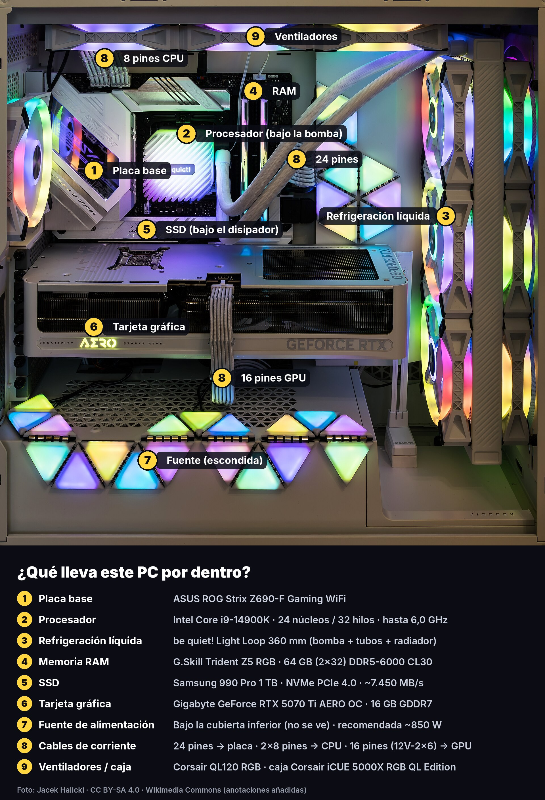

# ¿Cómo funciona un PC? (guion de vídeo en bucle)

Vídeo vertical (TikTok / Reels / Shorts) de **2:15 con voz en off**, sobre una foto real del interior de un PC gaming actual.
El final corta a mitad de frase (*"Y por eso, ahora ya sabes…"*) y el vídeo vuelve a empezar con *"…¿cómo funciona un PC?"*, de modo que la frase se completa al volver al principio.



## El PC de la foto

Son componentes reales: el autor de la foto los identificó en su ficha de Wikimedia Commons.

| Pieza | Modelo | Lo que importa para el vídeo |
|---|---|---|
| Caja | Corsair iCUE 5000X RGB QL Edition | Torre ATX con cristal templado |
| Placa base | ASUS ROG Strix Z690-F Gaming WiFi | Socket LGA1700, ranura PCIe 5.0 x16, M.2 conectado al procesador |
| Procesador (CPU) | Intel Core i9-14900K | 24 núcleos (8 de rendimiento + 16 de eficiencia), 32 hilos, hasta 6,0 GHz, hasta 253 W |
| Refrigeración | be quiet! Light Loop 360 mm | Líquida todo en uno: bomba sobre la CPU, 2 tubos y radiador de 360 mm |
| RAM | G.Skill Trident Z5 RGB 64 GB (2×32) DDR5-6000 CL30 | 2 módulos, es decir, doble canal |
| SSD | Samsung 990 Pro 1 TB (NVMe PCIe 4.0) | Hasta ~7.450 MB/s de lectura |
| Gráfica (GPU) | Gigabyte GeForce RTX 5070 Ti AERO OC 16 GB | 8.960 núcleos CUDA, 16 GB GDDR7, unos 300 W |
| Ventiladores | Corsair QL120 RGB | Techo, trasera y frontal |
| Fuente | No se ve: está bajo la cubierta inferior | Para este equipo se recomienda una de unos 850 W |

> Pusiste de ejemplo una RTX 5090 con 32 GB. He usado los componentes **reales** de la foto (RTX 5070 Ti + 64 GB) para que lo que se dice cuadre con lo que se ve. La 5070 Ti además se parece más a lo que monta la gente.

---

## Guion por bloques

Los tiempos son los del vídeo final con voz (`video/como-funciona-un-pc.mp4`). Si lo regrabas con tu voz, se moverán un poco.

### 0:00 – 0:11 · Gancho
- **Plano:** la foto entera.
- **Texto en pantalla:** **¿CÓMO FUNCIONA UN PC?**
- **Voz:**
  > ¿Cómo funciona un PC? Este PC gaming lleva por dentro una RTX 5070 Ti, un Intel i9-14900K y 64 gigas de RAM DDR5. Vamos pieza a pieza.
- **Resaltado:** gráfica, luego procesador y luego RAM, según los nombras.

### 0:11 – 0:18 · Placa base
- **Plano:** zoom a la placa base entera. Etiqueta: *01 · PLACA BASE · ASUS ROG Strix Z690-F Gaming WiFi*.
- **Voz:**
  > Todo va enchufado a la placa base. Es como una ciudad: cada pieza tiene su sitio y se hablan por miles de pistas de cobre, como carreteras.

### 0:18 – 0:37 · Procesador + ejemplo de Fortnite
- **Plano:** zoom al bloque blanco *be quiet!* (el procesador está debajo). Etiqueta: *02 · PROCESADOR · Intel Core i9-14900K · 24 núcleos · 6,0 GHz*.
- **Voz:**
  > Debajo de este bloque está el cerebro: el procesador. Un i9-14900K con 24 núcleos y hasta 6 gigahercios. Calcula todo lo que pasa en la partida: cada jugador, cada disparo, cada construcción.
  >
  > **Por eso en Fortnite, en modo rendimiento, que es donde más trabaja el procesador, este PC va a unos 400 o 500 FPS.**
- **Tarjeta:** POR ESO… · *Fortnite · Modo rendimiento · 1080p* · **≈ 400–500 FPS**

### 0:37 – 0:50 · Refrigeración líquida
- **Plano:** de la bomba a los tubos y de ahí al radiador del frontal. Etiqueta: *03 · REFRIGERACIÓN LÍQUIDA · be quiet! Light Loop 360 mm*.
- **Voz:**
  > Y como consume hasta 250 vatios, se calienta muchísimo. Por eso lleva refrigeración líquida: la bomba mueve el líquido por estos dos tubos hasta un radiador de 360 milímetros, y los ventiladores sacan el calor fuera.

### 0:50 – 1:07 · RAM + ejemplo de multitarea
- **Plano:** zoom a las 2 barras con luces. Etiqueta: *04 · MEMORIA RAM · G.Skill Trident Z5 RGB · 64 GB DDR5-6000 CL30*.
- **Voz:**
  > Estas dos barras con luces son la RAM: 64 gigas DDR5. Es la mesa de trabajo del procesador: lo que estás usando se carga aquí, porque es muchísimo más rápida que el disco. Y van dos para trabajar en doble canal: el doble de carriles.
  >
  > **Por eso puedes tener Fortnite, Discord, Chrome y OBS grabando a la vez sin que se trabe.**
- **Tarjeta:** POR ESO… · *Fortnite + Discord + Chrome + OBS* · **64 GB**

### 1:07 – 1:22 · SSD + ejemplo de tiempos de carga
- **Plano:** zoom al disipador *CTRL + WASD*, entre el procesador y la gráfica (el SSD está debajo). Etiqueta: *05 · ALMACENAMIENTO · SSD · Samsung 990 Pro 1 TB · NVMe PCIe 4.0*.
- **Voz:**
  > Aquí, bajo este disipador, está el disco: un SSD Samsung 990 Pro, conectado directo al procesador, que lee a más de 7.000 megas por segundo: unas 50 veces más que un disco duro antiguo.
  >
  > **Por eso Windows arranca en segundos y las partidas cargan casi al instante.**
- **Tarjetas:** VELOCIDAD DE LECTURA · **7.450 MB/s**, y luego POR ESO… · *Windows y partidas* · **en segundos**

### 1:22 – 1:46 · Tarjeta gráfica + ejemplo de Cyberpunk
- **Plano:** barrido por la gráfica, de izquierda a derecha. Etiqueta: *06 · TARJETA GRÁFICA · GPU · Gigabyte RTX 5070 Ti AERO OC · 16 GB GDDR7*.
- **Voz:**
  > Y esta bestia es la tarjeta gráfica: una RTX 5070 Ti con 16 gigas de memoria propia. Va pinchada en la ranura PCI Express y tiene casi 9.000 núcleos que dibujan cada imagen que ves, cientos de veces por segundo. Ojo: el monitor se conecta a la gráfica, no a la placa.
  >
  > **Por eso Cyberpunk, a 1440p con path tracing, va a unos 40 FPS a pelo… pero con DLSS 4 y generación de fotogramas pasa de 150.**
- **Tarjetas:** ERROR TÍPICO · **NO a la placa**, luego **≈ 40 FPS**, y luego **+150 FPS** (con DLSS 4 y generación de fotogramas)

### 1:46 – 2:02 · Fuente de alimentación y cables
- **Plano:** la cubierta inferior, luego el cable de 24 pines (a la derecha de la RAM), los de 8 pines arriba a la izquierda y el de 16 pines que baja a la gráfica. Etiqueta: *07 · FUENTE DE ALIMENTACIÓN · recomendada ≈ 850 W*.
- **Voz:**
  > ¿Y la energía? Aquí abajo, escondida, está la fuente de alimentación: convierte los 230 voltios del enchufe en 12 y los reparte por cables. Este gordo de 24 pines va a la placa, estos de arriba al procesador, y este de 16 pines a la gráfica, que ella sola se traga 300 vatios.
- **Tarjeta:** CONSUMO DE LA GRÁFICA · **300 W**

### 2:02 – 2:14 · Resumen: cómo trabajan juntas las piezas
- **Plano:** la foto entera. Arriba, la cadena **SSD → RAM → CPU → GPU → MONITOR**, que se va iluminando paso a paso.
- **Voz:**
  > Así que, cuando juegas: el SSD carga el juego en la RAM, el procesador calcula qué pasa, y la gráfica lo dibuja y lo manda al monitor. Cada vez que hace eso es un fotograma, y los que hace en un segundo… son tus FPS.
- **Texto:** **FPS = fotogramas por segundo**

### 2:14 – 2:15 · Final en bucle
- **Plano:** la foto entera, **el mismo encuadre que el primer fotograma**.
- **Voz:**
  > Y por eso, ahora ya sabes…
- **CORTE SECO**: el vídeo vuelve a empezar con *"¿Cómo funciona un PC?"*.

---

## Texto seguido para leer (teleprompter)

> ¿Cómo funciona un PC? Este PC gaming lleva por dentro una RTX 5070 Ti, un Intel i9-14900K y 64 gigas de RAM DDR5. Vamos pieza a pieza.
>
> Todo va enchufado a la placa base. Es como una ciudad: cada pieza tiene su sitio y se hablan por miles de pistas de cobre, como carreteras.
>
> Debajo de este bloque está el cerebro: el procesador. Un i9-14900K con 24 núcleos y hasta 6 gigahercios. Calcula todo lo que pasa en la partida: cada jugador, cada disparo, cada construcción. Por eso en Fortnite, en modo rendimiento, que es donde más trabaja el procesador, este PC va a unos 400 o 500 FPS.
>
> Y como consume hasta 250 vatios, se calienta muchísimo. Por eso lleva refrigeración líquida: la bomba mueve el líquido por estos dos tubos hasta un radiador de 360 milímetros, y los ventiladores sacan el calor fuera.
>
> Estas dos barras con luces son la RAM: 64 gigas DDR5. Es la mesa de trabajo del procesador: lo que estás usando se carga aquí, porque es muchísimo más rápida que el disco. Y van dos para trabajar en doble canal: el doble de carriles. Por eso puedes tener Fortnite, Discord, Chrome y OBS grabando a la vez sin que se trabe.
>
> Aquí, bajo este disipador, está el disco: un SSD Samsung 990 Pro, conectado directo al procesador, que lee a más de 7.000 megas por segundo: unas 50 veces más que un disco duro antiguo. Por eso Windows arranca en segundos y las partidas cargan casi al instante.
>
> Y esta bestia es la tarjeta gráfica: una RTX 5070 Ti con 16 gigas de memoria propia. Va pinchada en la ranura PCI Express y tiene casi 9.000 núcleos que dibujan cada imagen que ves, cientos de veces por segundo. Ojo: el monitor se conecta a la gráfica, no a la placa. Por eso Cyberpunk, a 1440p con path tracing, va a unos 40 FPS a pelo… pero con DLSS 4 y generación de fotogramas pasa de 150.
>
> ¿Y la energía? Aquí abajo, escondida, está la fuente de alimentación: convierte los 230 voltios del enchufe en 12 y los reparte por cables. Este gordo de 24 pines va a la placa, estos de arriba al procesador, y este de 16 pines a la gráfica, que ella sola se traga 300 vatios.
>
> Así que, cuando juegas: el SSD carga el juego en la RAM, el procesador calcula qué pasa, y la gráfica lo dibuja y lo manda al monitor. Cada vez que hace eso es un fotograma, y los que hace en un segundo… son tus FPS.
>
> Y por eso, ahora ya sabes…

*(436 palabras: 2:15 con la voz del vídeo.)*

---

## La voz en off

- La genera **Piper**, un programa de voz sintética que funciona sin internet, con la voz **`es_ES-davefx-medium`**: masculina, español de España, licencia **CC0** (libre, también para uso comercial).
- Algunas palabras se escriben de una forma y la voz las lee de otra para que suenen bien: *Fortnite* se lee "fórnait", *RTX 5070 Ti* "erre te equis cincuenta setenta te i", *SSD* "esesedé", *DLSS* "de ele ese ese", *Cyberpunk* "sáiber pank", etc. La lista está en `herramientas/voz.py`.
- La he comprobado transcribiéndola con Whisper: se entiende el guion completo, y los subtítulos van sincronizados con la voz con un error típico de menos de 0,1 s.
- **Para cambiar la voz:** en la misma página de voces de Piper hay otras en español (por ejemplo `es_ES-sharvard-medium`, que tiene voz de hombre y de mujer, o `es_MX-claude-high`, mexicana). Descarga el `.onnx` y su `.onnx.json` en `voces/` y ejecuta:
  ```
  python3 herramientas/voz.py --voz voces/es_ES-sharvard-medium.onnx --hablante 1
  python3 herramientas/render_video.py
  ```
  Con `--velocidad 0.85` habla más rápido y con `1.0`, más pausado.

## Cómo hacer que el bucle quede perfecto

1. **La última frase se queda sin terminar:** *"Y por eso, ahora ya sabes…"*. No hagas pausa ni pongas un "¡sígueme!" al final.
2. **El primer plano y el último son el mismo** (la foto entera, mismo encuadre), así no se nota el salto.
3. **Empieza a hablar en el fotograma 0** con *"¿Cómo funciona un PC?"*, sin silencio inicial.
4. **Usa un corte seco**, sin fundido a negro ni fundido de música. Si pones música, que sea un bucle que encaje con la duración, o que la última nota no "cierre".
5. Di *"ya sabes…"* con entonación de frase a medias, como si siguiera. Al volver al inicio se oye: *"…ahora ya sabes… ¿cómo funciona un PC?"*.

---

## De dónde salen los FPS (y por qué son aproximados)

- **Fortnite, modo rendimiento, 1080p: ≈ 400–500 FPS.** El modo rendimiento carga sobre todo el procesador. Los bancos de pruebas con un i9-14900K en ajustes bajos a 1080p dan unos 455 FPS con una RTX 5080 y unos 495 con una RTX 5090 ([fpsbench](https://fpsbench.com/game/fortnite/intel-core-i9-14900k-nvidia-geforce-rtx-5080)), y una guía estima unos 600–650 FPS para una 5070 Ti en modo rendimiento ([prosettings.net](https://prosettings.net/guides/fortnite-gpu/)). En una partida real cambia mucho: en el lobby o en creativo sube más, y en un final con muchas construcciones puede bajar a ~250.
- **Cyberpunk 2077, 1440p, path tracing: ≈ 40 FPS nativo, +150 FPS con DLSS 4 y generación múltiple de fotogramas.** Sin ayudas, las pruebas dan unos 38–50 FPS, y NVIDIA anuncia hasta 191 FPS a 1440p con DLSS 4 ([spawningpoint](https://spawningpoint.com/article/nvidia-rtx-5070-ti-review), [evezone](https://evezone.evetech.co.za/performance-pulse/rtx-5070-ti-cyberpunk-2077-at-1440p-fps-benchmark-optimal-settings)).
- Los FPS dependen del parche del juego, los drivers, la escena y los ajustes. Por eso en el vídeo siempre van con "unos" o "≈".

## Archivos de este repositorio

| Archivo | Para qué |
|---|---|
| `imagenes/pc-interior-original.jpg` | La foto limpia (1920×1920) |
| `imagenes/pc-interior-anotado.jpg` | La foto con cada pieza numerada y una leyenda |
| `imagenes/planos/*.jpg` | Un plano vertical 1080×1920 por pieza, sin texto, para montar en CapCut o Premiere |
| `video/como-funciona-un-pc.mp4` | **Vídeo final** 1080×1920 con voz en off, zooms, resaltados, tarjetas y subtítulos sincronizados |
| `video/voz.wav` | Solo la voz en off, por si quieres montarla tú con otra música o planos |
| `video/subtitulos.srt` | Subtítulos sincronizados con la voz (para importar en CapCut o Premiere) |
| `herramientas/` | Scripts que generan la voz, el vídeo y las imágenes (`guion_data.py` contiene el texto y los encuadres) |

## Créditos y licencia de la foto

Foto: **Jacek Halicki**, [*2025 Wnętrze komputera PC*](https://commons.wikimedia.org/wiki/File:2025_Wn%C4%99trze_komputera_PC.jpg), Wikimedia Commons, licencia [CC BY-SA 4.0](https://creativecommons.org/licenses/by-sa/4.0/).
Puedes usarla en el vídeo, incluso con fines comerciales, siempre que **cites al autor y la licencia** (por ejemplo, en la descripción: *"Foto: Jacek Halicki, CC BY-SA 4.0, Wikimedia Commons"*). Las versiones modificadas (la imagen anotada, los planos y el vídeo) se comparten con la misma licencia.
